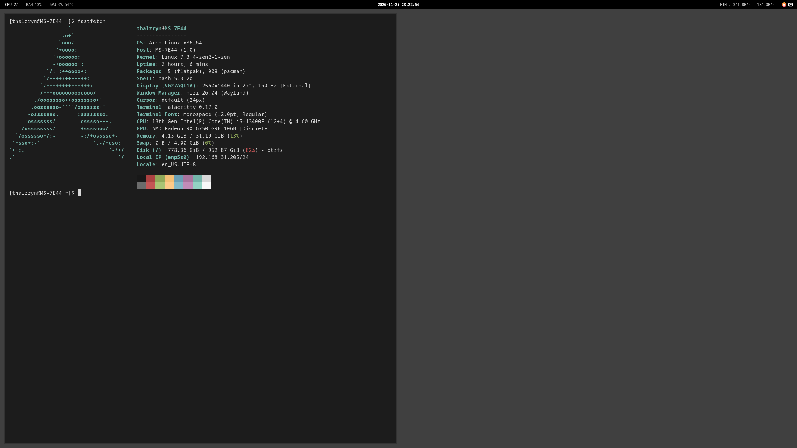

我的个人Linux
配置文件仓库，用于备份、整理和维护日常使用的桌面环境配置。

## 桌面截图

## 系统环境

-   **操作系统：** ArchLinux
-   **终端模拟器：** Alacritty
-   **应用启动器：** Fuzzel
-   **窗口管理器：** Niri
-   **状态栏：** Waybar

## 配置目录

| 目录 | 说明 |
|---|---|
| `alacritty/` | Alacritty 终端配置 |
| `fuzzel/` | Fuzzel 应用启动器配置 |
| `niri/` | Niri 窗口管理器配置 |
| `waybar/` | Waybar 状态栏配置、样式及脚本 |
| `scripts/` | 个人脚本 |

## 设计风格

-   极简主义
-   黑、白、灰为主色调
-   注重整洁与一致性
-   尽量减少不必要的视觉元素

## 说明

这里存放的是我个人使用的配置文件，主要用于备份和日常维护。

其他设备使用时，可能需要根据实际环境进行调整。

------------------------------------------------------------------------
